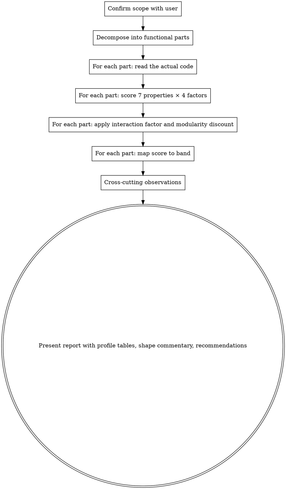

# Software Risk Assessment

## Overview

Decomposition-based risk assessment for a software change. The output is a per-part profile (the primary artifact), a derived score band per part, and a cross-cutting report highlighting where risk concentrates, where bundling inflates it, and which defeaters need verification.

Publish the profile, not the scalar. Two changes with the same total can have wildly different shapes, and the shape dictates the mitigation. Score parts independently; an aggregate score over a multi-commit branch hides which piece is actually loaded.

Announce at start: "I'm using the software-risk-assessment skill to profile this change."

See `framework.md` next to this skill for the full framework writeup with extended worked examples and rationale.

## When to Use

- User asks: "what's the risk of this change / branch / PR?", "should we ship this?", "where should we focus review?", "is this branch ready?", "should we split this PR?"
- You're about to merge a non-trivial change and want a structured second look
- A change touches multiple concerns and the right scope of review is unclear
- A change involves auth, data migration, new public surface, or a load-bearing refactor

Do NOT use for:
- A user asking for code review (use code-review tooling instead; this skill sizes the *case*, it doesn't review the code)
- Single-line fixes or pure documentation changes (the answer is "Routine" without running the framework)
- Architecture or design questions before code exists (the framework needs concrete diff to score)

## The Process



### Step 1: Confirm scope

Don't guess what "this change" means. Ask if unclear:

- A single commit? A range? A PR? A working tree?
- Where does the relevant work start? (e.g., `git log master..HEAD` may include rebase noise)
- Are there explicit boundaries the user already knows? (first commit, base branch, set of files)

If the user names a starting commit or branch boundary, use that exactly. If they say "the feature branch" and the diff vs base contains obvious noise (unrelated dependency updates, rebase artifacts), strip the noise and confirm what you're scoring.

### Step 2: Decompose into functional parts

Cut along **functional cohesion**, not files. A reasonable cut yields parts where each part is something that could ship as its own PR.

Heuristics for cuts:

- **Commit boundaries** are often a good starting point if the author has been disciplined.
- **Layer boundaries**: proto / wire contract vs. server vs. client vs. tooling vs. integration.
- **Concern boundaries**: new resource type, new permission verb, new state machine, new external API, new operator surface.
- **Per-target boundaries**: per-cloud (EC2 / Azure / GCP), per-platform, per-tenant.

Squash trivial commits (snapshots, fixups, formatting) into the functional unit they belong to. Treat RFD/docs commits as a separate Routine unit or exclude them.

### Step 3: Read the actual code for each part

**Don't score from commit messages or file counts.** Read enough of the actual diff to know:

- What property is genuinely stressed (e.g., does this *write* state, or just *read* it?)
- Whether the apparent surface is real (e.g., a `localhost`-only listener has near-zero Confidentiality reach)
- What's load-bearing vs. mechanical (generated `.pb.go` is mechanical; the `.proto` it came from is load-bearing)
- Whether tests exist that cover the loaded properties

Specific cheap checks worth doing:

- `grep` for `innerHTML` / `document.write` if HTML is involved — answers a Confidentiality scoring question fast
- Check listener bind addresses (`localhost` vs `0.0.0.0`) — answers Reach for new services
- Check for `template.HTML` / `template.JS` / unescaped interpolation if Go templates are involved
- Look at test files alongside production code — informs Comprehension gap
- Check if interfaces are enforced (gRPC, typed) vs. declared (Go interface with no integration test) — informs the modularity discount

Score from observation, not from the commit subject line. If a scoring instinct is high but cheap verification would change it, do the verification.

### Step 4: Score each part — 7 properties × 4 factors

For each part, produce a table over the seven baseline properties. Only include rows where the property is actually touched; omit untouched rows. A contribution of 1 (all factors = 1) still counts as touched and stays in the table.

The seven properties:

- **Correctness** — outputs match the spec under valid inputs. Stressed by changes to computation, especially where the spec is fuzzy or inputs diverse.
- **Integrity** — persistent state stays valid. Stressed by writes, mutations, migrations.
- **Availability** — service responds within tolerable bounds. Stressed by latency, throughput, resource consumption, failure-handling changes.
- **Access control** — only authorized principals act. Stressed by authn, authz, sessions, permission checks, tenancy isolation.
- **Confidentiality** — data flows only to authorized destinations. Stressed by new outputs, surfaced internal state, sensitive logging, new trust-boundary crossings.
- **Compatibility** — external contracts hold (APIs, schemas, file formats, persisted shapes). Stressed by changes to published interfaces or stored representations.
- **Operability** — failures can be detected, diagnosed, recovered. Stressed by reduced observability, added opacity, new failure modes without runbooks.

Four factors per property (scale: 1 / 2 / 4):

- **Stress depth** — how fundamentally the mechanism maintaining the property is altered. Cosmetic = 1; new mechanism replacing load-bearing piece = 4.
- **Reach** — internal + external surface relying on the property at this point. Leaf with one caller = 1; broad fan-in core abstraction = 4.
- **Comprehension gap** — how well the area is understood by whoever's making the change. Recent activity, authors available = 1; legacy, expert gone = 4.
- **Adversarial pressure** — active force trying to make the property fail. Internal batch = 1; public-facing surface with monetary value = 4. When a downstream review rates per-finding assumption likelihood on the `very-low / low / low-to-medium / medium / high` scale (argument-decomposition residuals, PR review threat-model tables), map 1 → very-low/low, 2 → low-to-medium/medium, 4 → high so the two ratings read consistently across one report.

Domain-specific properties (regulatory traceability, real-time deadlines, data residency, accessibility, SLAs) may be added if the change touches them. The seven are a starting basis, not a closed enumeration.

**Contribution** = Stress × Reach × Gap × Adversary.

### Step 5: Apply interaction factor and modularity discount

#### Interaction factor

Flag amplifiers, then pick the level:

- ×1 — clean, isolated, no bundling, well-tested neighborhood
- ×2 — one amplifier present
- ×4 — two or more amplifiers
- ×8+ — multiple amplifiers in a known-fragile area

Amplifiers to check (mechanical where possible):

- Bundled concerns (refactor + behavior change in one diff; multiple independent features)
- Common-mode design (one pattern reused across N integrations; one misread shared across N changes)
- Touches recently-reverted files or files with ≥3 reverts in the last quarter
- Crosses a known-fragile interface (per project policy)
- Deployment non-atomicity (cross-instance write/read dependency during rollout)
- Latent bug exposure in surrounding code

#### Modularity discount

Audit the touched area:

- ×1.0 — pretend modularity (shared globals/DB/cache) or wrong-axis modularity (typical changes cross many boundaries)
- ×0.8 — declared contracts, generally respected, no enforcement
- ×0.6 — enforceable contracts (types, integration tests against the interface)
- ×0.4 — enforceable contracts plus strong fault isolation (separate process/service with hard boundary)

Apply discount **after** the interaction factor. Modularity reduces the combined risk, not per-property contributions.

**Final = Raw × Interaction × Modularity.**

### Step 6: Map score to band

- **Routine (0–10)** — standard PR review; no written case required
- **Standard (11–50)** — review plus tests addressing each loaded property; brief PR description naming the loaded properties
- **Elevated (51–150)** — domain expert review; written assurance case; staged rollout with explicit verification
- **High (151–500)** — pre-implementation design review; full assurance case with named defeaters and rollback plan; named accountable owner
- **Critical (>500)** — formal sign-off; multi-reviewer assurance case; dependency mapping; rehearsed rollback; monitoring with defined success criteria

Bands drive process, not feelings. Most changes should be Routine; a handful elevated; very few critical. If everything lands in the same band, the framework has lost discriminating power for this codebase and the bands need recalibrating. Flag this in the report.

### Step 7: Cross-cutting observations

After the per-part profiles, surface:

- **Where risk concentrates.** Which one or two parts carry most of the loaded risk? Test investment goes there.
- **Where bundling drives the score.** If a part's ×2/×4 interaction factor would drop to ×1 by splitting, name the split.
- **Ordering effects.** Did one part absorb pattern-design risk so derivative parts could be cheap? (e.g., first cloud integration paying for the next two.) If parts shipped in the wrong order, flag it.
- **Defeaters to verify.** Each amplifier you flagged is a named defeater. Each "I scored X high until I checked Y" is a one-time verification the reader should reproduce.
- **Shape, not just numbers.** "Heavy on Access control" and "heavy on Compatibility" produce the same total but need different mitigations. Make the shape explicit.

### Step 8: Present the report

Structure (concise, no fluff):

1. **Scope note.** One line stating what you scored and (if relevant) what you excluded.
2. **Per-part section.** For each part: a 7×4 table (omit zero rows), Raw / Interaction / Modularity / Final / Band, one paragraph of shape commentary.
3. **Cross-cutting observations.** A short list.
4. **Recommendations.** Tied to specific parts and specific properties (e.g., "split #5 to drop the ×2 interaction" / "verify #2's per-verb RBAC tests cover the auth surface"). Don't issue generic advice.

## Worked Example (compressed)

One concrete profile, to anchor the table format. Take a state-machine tracker package: Correctness=16 (S=4, R=2, G=2, A=1), Integrity=8, Availability=4, Operability=4. Raw 32, ×1 interaction, ×0.6 modularity, Final ~19. **Standard.** Shape: Stress=4 on Correctness is the highest single factor; test investment concentrates here — mutation-score or transition-exhaustiveness, not just line coverage.

Three cross-cutting patterns to watch for (each named in the report):

- **Concentration.** When one part scores ~19 and others score 1-6, half the assurance work belongs to that one part.
- **Bundling-driven score.** A part with ×2 interaction purely from bundling (refactor + behavior change, or integration + new API + proto field in one diff) drops to ×1 if split. Same code, lower review burden.
- **Ordering.** First-of-N pattern integrations carry ×2 (establishes the pattern); subsequent integrations are derivative at ×1. Wrong order moves cost without reducing it.

For longer worked examples (logging tweak, query optimization, schema migration, auth refactor), see `framework.md`.

## Patterns That Affect Scoring

Open-ended catalog of patterns that change how a change should be scored. Each pattern names what to look for, which factor / property it loads, and what mitigation it suggests. Patterns are additive nudges to the existing factors, not replacements — more than one can apply to the same change. Reference patterns by name in reports. Add patterns as incidents reveal them; this list is not closed.

### Widely-used API with non-enforced contract

*An API expresses an obligation — invariant on paired fields, ordering of calls, sentinel handling — that the type system can't enforce, and N independent consumers must each uphold it.*

Each call site is an independent comprehension event; violations are silent until cross-system testing; future consumers inherit the obligation without compile-time signal.

Effect on scoring:

- **Comprehension gap** counts every consumer, not just the author. Treat Gap as ≥2 for non-obvious contracts with N consumers even if the author is fluent — the worst comprehender among the consumers is the bound, not the average.
- **Reach** weight is amplified because each call site fails independently, unlike a single abstraction where one fix patches all callers.
- Loads **Correctness** (every misuse is a regression) more than **Compatibility** (the surface hasn't changed; callers misuse it).

Mitigation: surface the contract into the type system (typed wrappers, builder pattern, phantom types) or into lint / exhaustive integration tests. Documentation is necessary but not sufficient.

Worked instance: `ResourceID` / `ResourceAccessID` pair in Teleport PR #61168. The helper `UnwrapResourceAccessIDs` existed because the invariant *"AllowedResourceIDs MUST contain the plain subset of AllowedResourceAccessIDs"* couldn't be expressed in the proto-generated Go types. Three consumers violated it independently in follow-ups (#60123, #66556, #66870).

### Backward-compat shim with in-band signaling

*A sentinel value, magic constant, or "old code happens to deny on this" trick to maintain compatibility with older readers, where every intermediary in the data path must preserve the value byte-for-byte through every encode → decode → re-encode cycle.*

Effect on scoring:

- **Correctness** stress depth lifts to 4: a load-bearing semantic ("what does an empty field mean?") is being redefined.
- **Operability** loads: the failure mode is several layers downstream of where the value was lost; typically a "permission denied" with no version-skew indication.
- **Interaction factor** lifts to ×2 minimum: the shim shares fate with every intermediary that handles the field.

Mitigation: prefer out-of-band signaling — refuse-to-issue at the producer, envelope versioning with a mandatory `version > max_known` check, capability negotiation, or a new typed wrapper. If in-band is unavoidable, give the sentinel a dedicated type so the compiler can find every handling site.

### Wire-type field added on an artifact that outlives a deploy

*A new proto / JSON / header field on a long-lived artifact (cert, token, identity, audit event, persisted state) that crosses independently-upgradable component boundaries.*

Certs and tokens are especially loaded because they survive hours-to-days past their producer's deploy. Old readers that silently ignore unknown fields (proto3 default) can silently weaken correctness or security.

Effect on scoring:

- **Compatibility** stress lifts to 4 if old readers can't safely ignore the new field (e.g. it's security-critical); 2 if they can ignore but behavior changes when honored.
- **Reach** is the cross-product of writer-versions × reader-versions × intermediary-versions, not just call sites.
- Backport failures here are signal, not noise — they reveal compatibility-matrix cells that haven't been thought through.

Mitigation: explicit producer × consumer version matrix in the PR description; failure mode for each cell in one sentence; explicit mechanism (refuse-to-issue, envelope versioning, capability negotiation) named — not "we'll handle it case-by-case."

### Pattern-first PR (types-only / scaffolding)

*A PR that introduces types, helpers, or scaffolding for a feature whose consumers will land in follow-up PRs.*

The diff looks small and uncontroversial — but every contract this PR establishes implicitly will be implemented N times. Once consumer PRs land, the contract is fossilized in whatever the first consumer happened to do, correct or not.

Effect on scoring:

- **Comprehension gap** counts forward consumers, not just the author of this PR.
- The **interaction factor** doesn't fire on this PR but is structurally embedded in the next N PRs.
- If consumer PRs ship same-day or same-week by the same author, treat the PR family as one unit for scoring. The artificial split is a packaging choice, not a risk reduction.

Mitigation: documented invariants on the *types* (not on the helpers); examples of correct usage in godoc; tests that demonstrate the intended contract. This PR is the only chance to write the contract down with the design fresh in mind.

Worked instance: Teleport PR #61168 (types-only) merged same day as #60123 (consumer wiring), same author. Two follow-up bug PRs months later (#66556, #66870) fixed contract violations in #60123. Scoring #61168 alone missed the bundled-with-#60123 risk; scoring the pair together would have surfaced it.

## Calibration and Operation

The framework only works if operated honestly. Five disciplines:

- **Mechanically checkable factors win.** "Does this diff touch any file under `/auth/`?" > "Is this auth-risky?". Derive factor values from diff and repo state where possible.
- **Ordinal calibration, not measurement.** "Touching auth is roughly four times a logging change" is the discipline; arguing over 4 vs. 5 is the trap.
- **Recalibrate from incidents.** Every postmortem asks: would this framework have flagged the change? If not, what's missing?
- **Watch the distribution.** If most changes land in the same band, discriminating power is lost. Quarterly audit recommended.
- **Publish profiles, not just scores.** The vector preserves *why* the risk is loaded — which drives mitigation.

## Red Flags

These thoughts mean stop and verify:

- "I'll just score from the commit message" — read the actual diff, then score
- "Everything is Standard" — the framework has lost discriminating power; check whether you're inflating low rows or whether the codebase genuinely lives in one band
- "I'll score the whole branch as one unit" — almost always wrong; decompose first
- "The score feels too low / too high" — the score is what it is; if your gut disagrees, you missed a factor or an amplifier; go find it
- "I don't need to look at tests" — test presence and quality informs Comprehension gap and modularity discount; check
- "PoC / experimental framing absolves risk" — it doesn't; users rely on what ships

## What This Skill Deliberately Does Not Do

- It does not produce a probability of failure. It produces a structured *concern*: "how much should we worry, in what ways, what should we do?"
- It does not eliminate judgment. It *locates* judgment in specific, named places where it can be reviewed and recalibrated.
- It does not substitute for code review. It sizes the *case* the change needs to make.
- It does not work in pretend-modular systems. If every module shares state through the back door, the discount is ×1.0 across the board and the score is always elevated; the right response is to fix the modularity, not the changes.

## Output Format

```
## Scope

<one line: what's being scored, what's excluded>

## Part 1: <short name>

| Property | S | R | G | A | Contrib |
|---|---|---|---|---|---|
<rows; omit zeros>

**Raw N · ×M interaction · ×K modularity · Final F — Band.**

Shape: <one paragraph — what's loaded, what it implies, what mitigation it suggests>

## Part 2: ...

[repeat]

## Cross-cutting observations

- <bullet on concentration>
- <bullet on bundling-driven score>
- <bullet on ordering>
- <bullet on defeaters to verify>

## Recommendations

1. <tied to a specific part and property>
2. <tied to a specific part and property>
...
```

Keep the report concise. Tables are dense by design; commentary is one paragraph per part, not a page.
