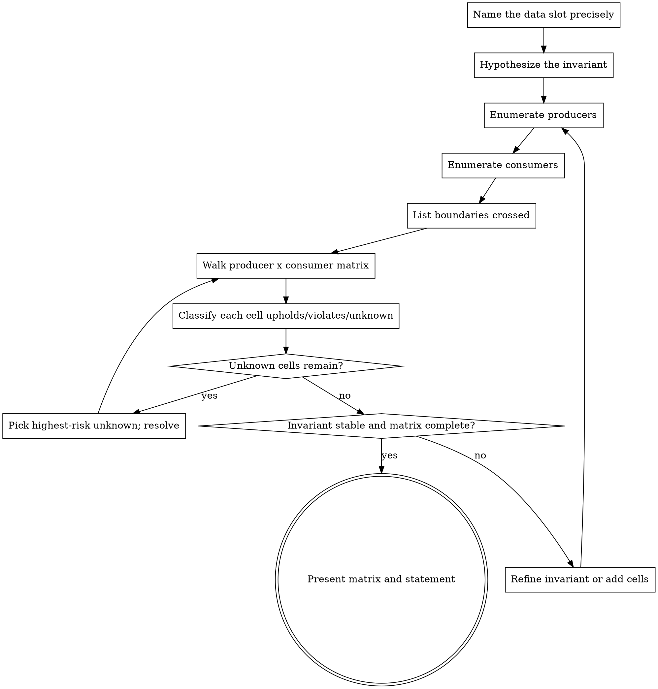

# Tracing Invariants

## Overview

A procedure for tracing an invariant — a property that must hold on some data — across the producers and consumers that share it. The artifact is a producer × consumer matrix with each cell classified as upholds / violates / unknown, plus a one-sentence statement of the invariant.

Use it when a change touches shared data and you can't yet say with confidence what will break. The procedure forces enumeration before judgment, which is where most "looked fishy but I dismissed it" misses come from.

Announce at start: "I'm using the tracing-invariants skill to map this change."

## Core idea

The substrate is always data — a struct field, an error, a header, a row, a byte on the wire. What we care about is a **property** of that data:

- **Direct** — the value at this slot equals X / is non-empty / has type T
- **Relational** — these N slots jointly satisfy P (e.g., "exactly one is set", "B is derived from A")
- **Temporal** — after producer X runs, slot S holds property P
- **Provenance** — the value in slot S was produced by authority Q

Call this property an **invariant** when it must hold for the system to work. The skill's job is to make that invariant explicit, find every site that has to maintain it, and classify whether each site does.

## When to Use

- Reviewing a change to a struct field, function return type, error sentinel, header / cookie / claim, config key, env var, on-disk format, queue message, or other shared data slot
- About to score a software-risk-assessment finding and the change touches data shared across modules
- A piece of code "looks fishy" but you can't yet articulate the failure mode
- A regression has been reported and you want to characterize how many other call sites are affected
- Designing a new shared data slot and you want to write down what producers and consumers must agree on

Do NOT use for:

- Pure refactors with no semantic change (renaming a local variable, splitting a function)
- Single-callsite changes where the producer/consumer graph trivially has one node on each side
- Code that doesn't share data across modules (a self-contained pure function with no external observers)

## The Process



### Step 1: Name the data slot precisely

A precise name has three parts:

- **Which slot.** Field path, message field, header name, key in a map, byte offset — whatever uniquely identifies the data location.
- **Which moment.** Before parse / after parse / at serialize / at read / when held in cache / when crossing the boundary. The same slot at different moments often has different invariants.
- **In which type or carrier.** Disambiguate when the same name appears in multiple types, messages, or formats.

Imprecise: "the response field." Precise: "the `status` field in the API response object, at the moment the client deserializes the wire frame, in version `v2` of the schema."

If you can't name the slot in this form, you don't know what you're tracing. Stop and re-read until you can.

### Step 2: Hypothesize the invariant

State the invariant in one sentence, in the form "at \[moment\], \[slot\] satisfies \[property\]."

You may not know the invariant yet. That's fine — derive a hypothesis by:

- **From consumers.** Each consumer encodes an implicit assumption about the data. The intersection of those assumptions IS the invariant.
- **From producers.** A "validate" or "normalize" or "canonicalize" helper exists for a reason. What does it produce that the raw input didn't?
- **From naming.** A helper named `Unwrap*`, `Canonical*`, `Validated*` maintains some property. What is it?
- **From the change itself.** What is the author trying to ensure? Their patch is evidence of a believed invariant.

If multiple plausible invariants exist, write them all down. The matrix walk will tell you which one(s) actually hold.

### Step 3: Enumerate producers

Every code path that can assign, append-to, populate, or otherwise set the slot. Crucially, include **implicit producers** — the ones a caller didn't write but that still set the slot:

- Parsing / deserialization (often populates fields the caller never touched explicitly)
- Struct-literal or builder construction
- Field-by-field copies and reassignments (e.g., `dst.X = src.X` or `dst = src`)
- Library or framework callbacks that mutate the slot
- Default / zero values (a missing producer is still a producer — of "the zero value")
- Cached values restored from persistence

Text search is necessary but rarely sufficient. Implicit producers — especially parsers that populate fields a caller never named — are the most common source of missed cells. Read the docs for any parser, deserializer, or framework callback in the path.

### Step 4: Enumerate consumers

Every code path that reads the slot, branches on it, serializes it, or depends on it. Include library and runtime code you don't own:

- Standard-library or framework functions that consume the slot during marshalling, parsing, or template rendering
- Downstream serializers (proto, JSON, custom encoders)
- Reflection-based readers (validators, ORM, logging frameworks)
- Cross-process or cross-host consumers reached via wire format
- The "missing" consumer — code that *should* read the slot but doesn't. That absence may itself be a finding

### Step 5: List boundaries crossed

For each boundary the slot crosses, name what serializes on one side and what re-parses on the other:

- **Process boundaries** — RPC, IPC, pipes. What's the wire format? Are unknown fields preserved or dropped?
- **Version boundaries** — older code reading newer data (or vice versa). Same format, different semantics.
- **Persistence boundaries** — written to disk, database, cache, queue. Read back later, possibly by a different version or actor.
- **Trust boundaries** — data crossing from less-trusted to more-trusted (or vice versa). Validation, sanitization, or refuse-to-handle must happen at the crossing.
- **Language / format boundaries** — translation between encodings (text ↔ binary, units, code pages) loses or alters meaning if not idempotent.

Boundary crossings are where invariants get silently dropped. A value set on one side that's invisible to the parser on the other side is a silent-degrade failure mode; reviewers should treat each boundary as a possible drop site by default.

### Step 6: Walk the producer × consumer matrix

For each (producer, consumer) pair, classify the cell:

- **Upholds** — the producer's output, when reaching this consumer, satisfies the invariant
- **Violates** — the producer's output, when reaching this consumer, does NOT satisfy the invariant
- **Unknown** — the cell hasn't been verified; you don't yet have evidence either way

If your producer or consumer list is large, the matrix is large. That's fine — the table is the artifact. Don't compress it away.

### Step 7: Resolve unknowns

For each unknown cell, decide:

- Is the risk of this cell low enough that "unknown" is acceptable? (Document the reason.)
- Or do you need to verify? If so: read the code, run a test, or dispatch a focused query.

Pick highest-risk unknowns first. "Highest-risk" usually means: most adversarial consumer, most popular producer, or crossing the most boundaries.

### Step 8: Refine and re-walk

You may discover, mid-walk, that:

- Your invariant statement is wrong or too narrow (refine it)
- A new producer or consumer appears (add it)
- A boundary you didn't list matters (list it)

Loop back. This is normal; the first hypothesis is rarely the right one.

### Step 9: Present the artifact

A short report:

```
## Invariant

At [moment], [slot] in [type] satisfies [property].

## Producers

- [producer A] — [path/file:line] — sets via [mechanism]
- [producer B] — ...

## Consumers

- [consumer A] — [path/file:line] — reads via [mechanism]
- [consumer B] — ...

## Boundaries

- [boundary name] — serializer / parser / version-skew note

## Matrix

| Producer \ Consumer | C1 | C2 | C3 |
|---|---|---|---|
| P1 | ✓ | ✓ | ? |
| P2 | ✗ | ✓ | ✓ |

(✓ upholds, ✗ violates, ? unknown)

## Findings

- (✗ cells) — [name the failure, link to code]
- (? cells) — [name what was deferred and why]
```

The matrix is the deliverable, not the prose around it.

## Modes

The same procedure handles several distinct review tasks. The mode is just where you enter the loop and what makes you exit:

| Mode | Entry condition | Exit condition |
|---|---|---|
| **Discovery** | Don't yet know the invariant | Invariant statement is stable across two iterations |
| **Verification** | Have an invariant; want to confirm it holds | All cells classified as ✓ or accepted-unknown |
| **Violation-hunting** | Suspect breakage; want to find where | All ✗ cells located and qualified |
| **Characterization** | Found one violation; want to know if more exist | All cells walked; all ✗ counted |
| **Design** | Designing a new slot; want to write contract before code | Invariant statement + producer list + consumer list complete |

If the user's question is "what could go wrong?", you're in Verification + Violation-hunting. If "this regressed, where else is it broken?", you're in Characterization.

## Worked example: a real miss

**Setup.** A PR adds, in a hot cert-issuance path:

```go
if len(req.Subject.Names) > 0 {
    req.Subject.ExtraNames = req.Subject.Names
}
```

A reviewer flagged it as suspicious but framed the concern as "no caller pre-populates ExtraNames independently of Names" — and downgraded the severity. The patch shipped and broke `tsh aws`, `tsh gcp`, `tsh azure`, `tsh proxy app`.

**Where the trace would have caught it.**

- **Name the slot.** "`pkix.Name.ExtraNames` at the moment `x509.CreateCertificate` serializes the cert."
- **Hypothesize the invariant.** "`ExtraNames` reflects what the caller intends to put in the cert subject."
- **Enumerate producers.** Two flavors:
  1. *Explicit* — callers that set `pkix.Name{ExtraNames: [...]}` (the new code path in WDS).
  2. *Implicit* — `x509.ParseCertificate` and `x509.ParseCertificateRequest` populate `Subject.Names` from any parsed cert / CSR. Any caller that passes a parsed `Subject` along is, transitively, a producer of `Names`.

  The new patch promotes `Names` to `ExtraNames`, so anything that wrote to `Names` is now a producer of `ExtraNames`.

- **Enumerate consumers.** `x509.CreateCertificate` (stdlib) — uses `ExtraNames` if non-empty, *overriding* the typed fields like `CommonName`.

- **Walk the matrix.**
  - (WDS sets ExtraNames) × (CreateCertificate honors ExtraNames) = ✓ intended.
  - (caller passes parsed Subject with Names populated) × (CreateCertificate honors ExtraNames via the new copy edge) = ✗ unintended. The parsed cert's `CN=foo` now wins over whatever `Subject.CommonName` the caller had set.

The second row is where `tsh aws` etc. lived. The miss was that "no caller pre-populates ExtraNames" answered the wrong question — the actual producer was *parsing populating Names*, transitively reaching ExtraNames via the new edge. Walking the matrix with both producer flavors enumerated forces you to notice the second row.

## Red flags

These thoughts mean you're about to miss something:

- "No caller depends on this" — check both axes. Did you enumerate implicit producers (parsers, copies, defaults)?
- "It's obviously safe" — write down the invariant in one sentence. If you can't, you don't know that yet.
- "I'll just spot-check one path" — the matrix is the artifact. One cell is not a matrix.
- "The compiler would catch this" — only for direct-property invariants typed at field level. Relational, temporal, provenance invariants are invisible to compilers.
- "There's a helper for that" — every consumer must go through the helper. Did you verify that, or did you assume it?
- "The change is small" — the size of the diff has nothing to do with the size of the producer × consumer matrix. A one-line patch can affect every cell.

## What this skill deliberately does not do

- It does not produce a probability of failure. It produces a structured concern: which cells are dangerous, which are safe, which are unverified.
- It does not replace running the code. If a cell is high-risk and unknown, run the code or read the cell exhaustively. The matrix is a map, not a guarantee.
- It does not enumerate every cell for you. The reviewer still has to do the producer/consumer walk; the skill just forces them to do it before scoring.
- It is not a substitute for software-risk-assessment. That skill sizes the case; this skill provides the evidence that the case rests on. Use this when an invariant is in question; use risk-assessment when sizing the overall change.

## Output Format

Keep the report dense:

```
## Invariant

At [moment], [slot] in [type] satisfies [property].

## Producers / Consumers / Boundaries

(short lists; one bullet each)

## Matrix

(producer × consumer table with ✓ / ✗ / ? per cell)

## Findings

- ✗ cells named, with file:line
- ? cells named, with why deferred
```

If the matrix has more than ~30 cells, group producers or consumers by family before tabulating.
